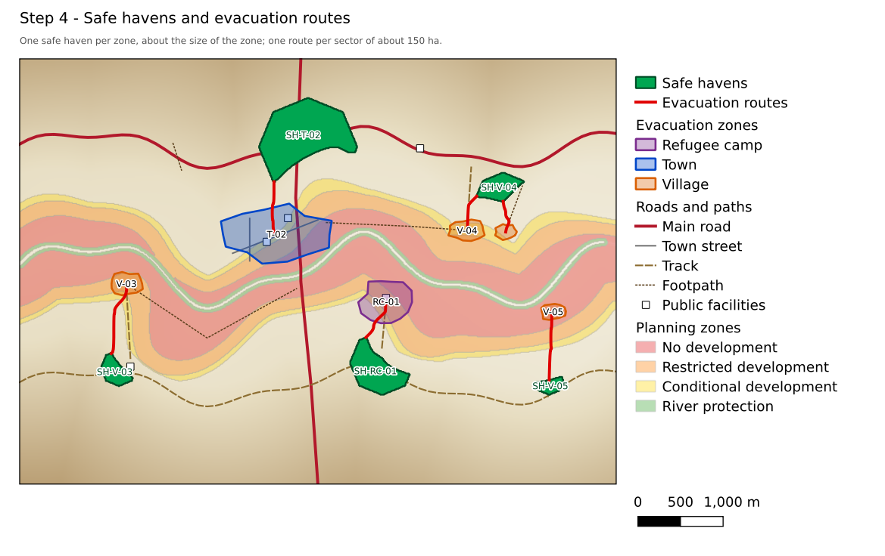

# Flood Zoning & Evacuation Planner

A QGIS plugin that turns flood-depth maps from any hydraulic model into practical
flood-risk management products:

- **spatial planning zones**: where building should be forbidden, restricted or allowed with
  conditions, plus a river protection zone;
- **evacuation zones**: the settlements that must be evacuated, grouped and coded;
- **safe havens**: dry, high ground of about the same size as each zone;
- **evacuation routes**: the easiest walking routes to the safe havens;
- **report tables**: ready-to-use tables in Word or HTML.

It works for any area in the world, in any coordinate system, and needs nothing beyond a
standard QGIS installation (QGIS 3.34 or newer, QGIS 4 supported).



**📖 [User guide with a worked example](docs/user_guide.md)**

---

## Tools

All tools are in the **Processing Toolbox → Flood Zoning & Evacuation Planner**. Use them in this
order; each one uses the results of the one before.

| Step | Tool | What it does |
|---|---|---|
| 1 | **River corridor** | River channel polygon (from river polygons, from the deep-water strip of a frequent flood along river lines, or a fixed width) and a protection buffer along both banks. |
| 2 | **Spatial planning zones** | Red / orange / yellow zones from up to four flood events (e.g. 2-, 10-, 50-, 100-year) and flood depth, with a rule for existing settlements and smoothing into a few continuous zones; green river protection zone. Run once per scenario to compare. |
| 3 | **Evacuation zones** | Whole settlements within a distance of the flood zones, grouped by type (town, village, camp, ...), optionally never across the river. Codes like `V-03`, `RC-01`. |
| 4 | **Safe havens and evacuation routes** | One safe haven per zone (dry, away from the flood, optionally checked against a DEM, preferably near facilities and roads) and least-cost walking routes that use roads first, then paths, then open ground, avoid deep water and cross the river only on roads. |
| 5 | **Report tables** | Key figures and plain-language tables for zones, scenario comparison, evacuation zones, safe havens and routes, with a "How to read" note under each table. |

Default rules (all adjustable):

| Zone | Default rule |
|---|---|
| No development (red) | ≥ 0.3 m deep in the very frequent or frequent flood, or > 1 m deep in the design flood |
| Restricted development (orange) | ≥ 0.3 m deep in the medium flood, or 0.5–1 m deep in the design flood |
| Conditional development (yellow) | Flooded only in the design flood, 0.3–0.5 m deep |
| Protection (green) | River protection buffer (30 m) |

---

## Installation

**From QGIS:** *Plugins → Manage and Install Plugins*, search for
**Flood Zoning & Evacuation Planner**, *Install*.

**From a zip file:** download `flood_zoning_evacuation_planner-x.y.z.zip` from the
[Releases](../../releases) page, then *Plugins → Manage and Install Plugins → Install from ZIP*.

No extra Python packages are needed: the plugin uses only GDAL and NumPy, which come with QGIS.

---

## For developers

```bash
pytest tests/test_zoning_rules.py tests/test_costpath.py tests/test_report.py   # no QGIS needed
python3 scripts/run_tests.py -v tests                  # all tests, inside QGIS (e.g. qgis/qgis Docker image)
python3 scripts/make_example_data.py example_data      # example data of the user guide
python3 scripts/run_example.py example_data out        # run the example and draw the figures (QGIS)
python3 scripts/package.py                             # build the plugin zip
```

- `core/` – plain NumPy / GDAL logic: zoning rules, raster tools, least-cost routing
  (`costpath.py`), safe-haven and route planning (`evacuation.py`), report writer (`report.py`).
- `algorithms/` – the QGIS Processing tools.
- Tests run on every push with the QGIS LTR and the latest QGIS (GitHub Actions). The
  *Example and figures* workflow re-creates the guide's example and figures.

---

## Licence

GNU General Public License v2.0 or later. See [LICENSE](LICENSE).

## Author

Muhammad Uzair Khan – uzairkhan1478@gmail.com

Bug reports and suggestions: [GitHub issues](../../issues).
