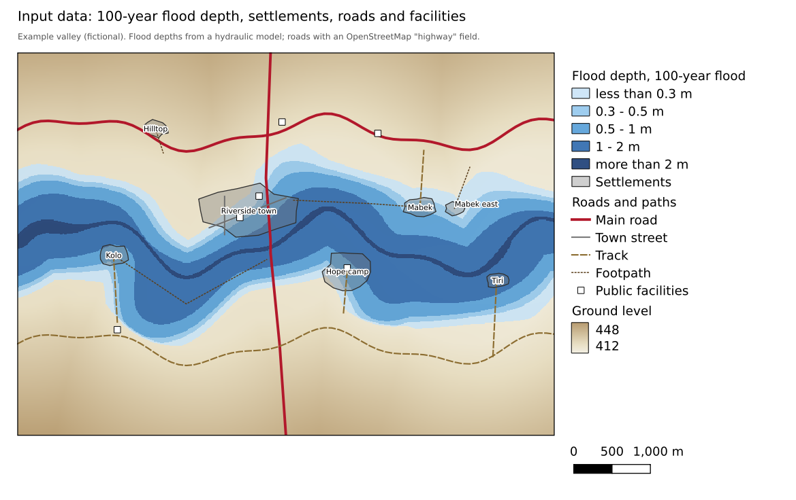
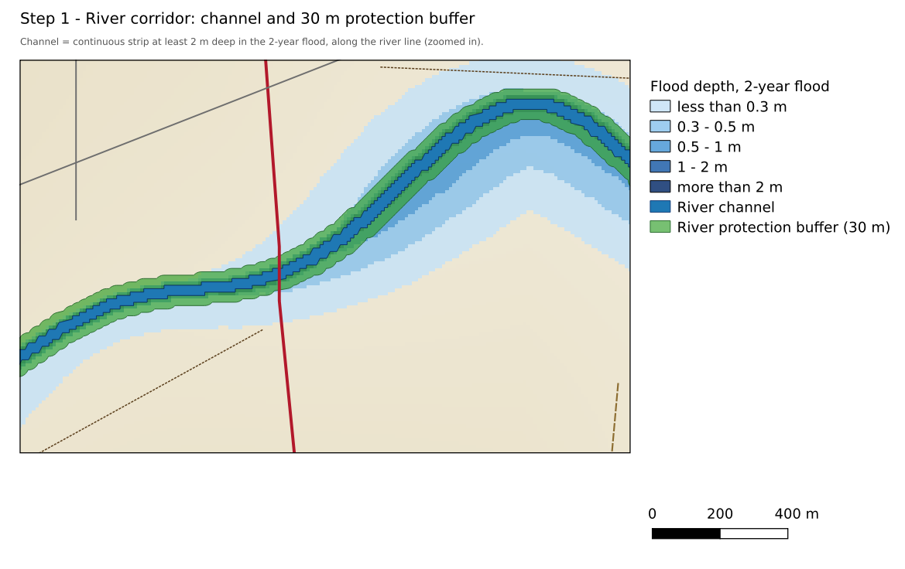
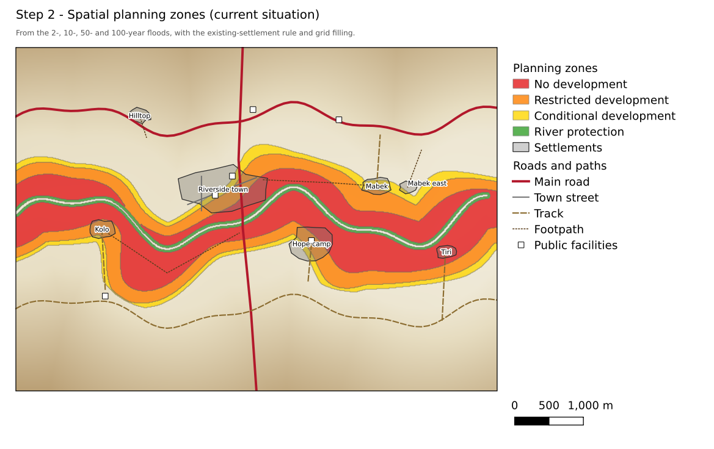
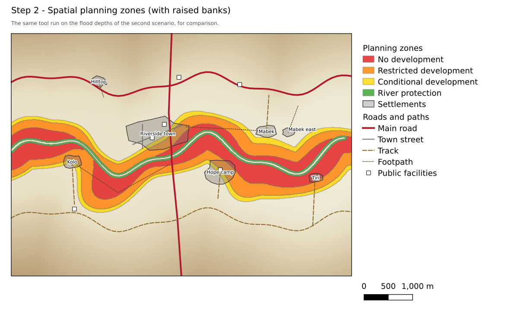
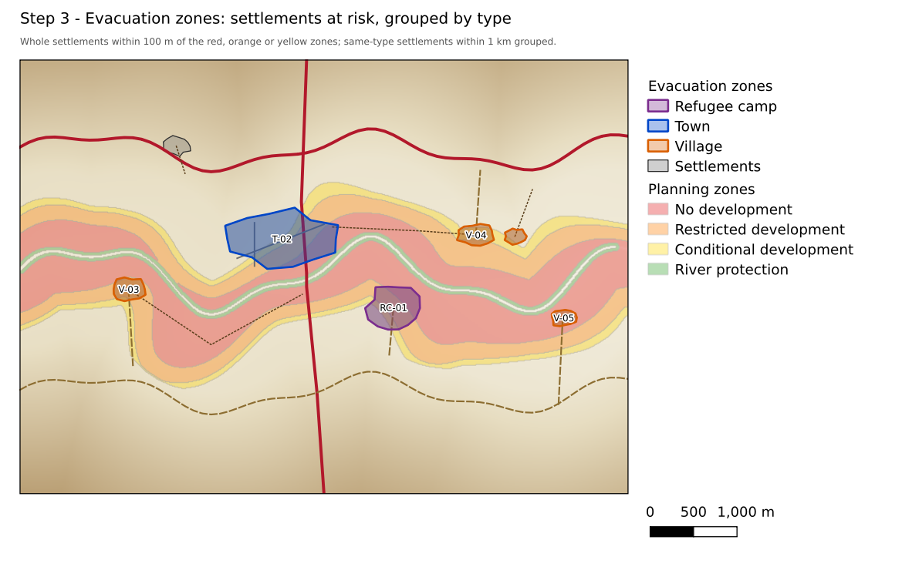
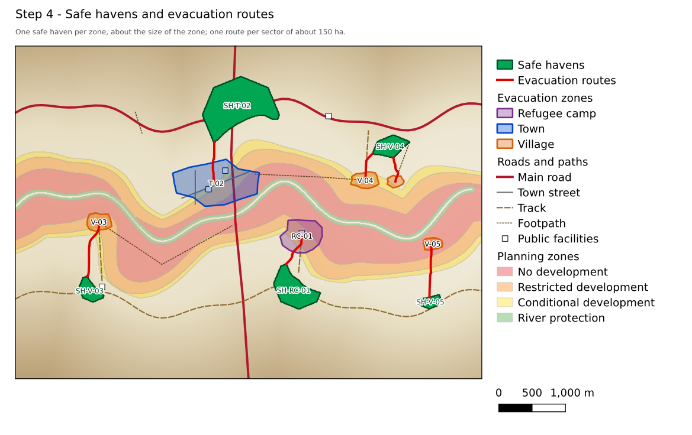
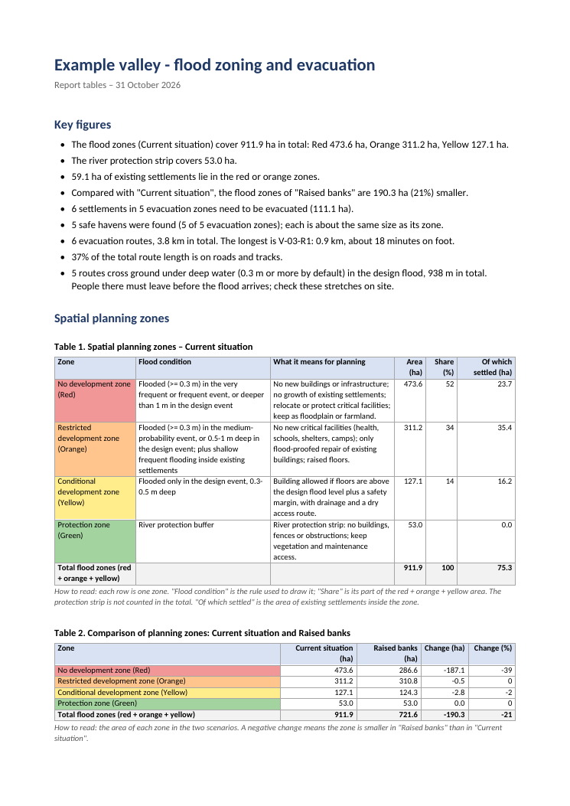

# User guide – Flood Zoning & Evacuation Planner

This guide explains, step by step, how to turn flood maps into **planning zones**, **evacuation
zones**, **safe havens**, **evacuation routes** and **report tables** with the QGIS plugin
*Flood Zoning & Evacuation Planner*. Each step is shown on a small worked example that you can
reproduce yourself.

**Contents**

- [What the plugin does](#what-the-plugin-does)
- [What you need](#what-you-need)
- [Before you start](#before-you-start)
- [Step 1: River corridor](#step-1-river-corridor)
- [Step 2: Spatial planning zones](#step-2-spatial-planning-zones)
- [Step 3: Evacuation zones](#step-3-evacuation-zones)
- [Step 4: Safe havens and evacuation routes](#step-4-safe-havens-and-evacuation-routes)
- [Step 5: Report tables](#step-5-report-tables)
- [Checking the results](#checking-the-results)
- [Common questions](#common-questions)
- [The worked example](#the-worked-example)

---

## What the plugin does

The plugin adds five tools to the **Processing Toolbox** (*Processing → Toolbox*, then search for
"Flood Zoning"). They are used in this order, and each one uses the results of the one before:

| Step | Tool | Gives you |
|---|---|---|
| 1 | River corridor | The river channel as a polygon and a protection strip along both banks |
| 2 | Spatial planning zones | Where building is forbidden (red), restricted (orange), allowed with conditions (yellow), plus the river protection zone (green) |
| 3 | Evacuation zones | The settlements that must be evacuated, grouped into coded zones |
| 4 | Safe havens and evacuation routes | One safe place per zone and the walking routes to it |
| 5 | Report tables | Ready-to-use tables in Word or HTML for your report |

You can stop after any step. For example, if you only need planning zones, run steps 1 and 2.



*The worked example: a fictional river valley with a town, villages and a refugee camp. Blue shows
the depth of the 100-year flood.*

---

## What you need

| Data | Needed for | Notes |
|---|---|---|
| **Flood depth rasters** [m] | Steps 1, 2, 4 | From any hydraulic model (HEC-RAS, TUFLOW, LISFLOOD-FP, MIKE, ...). Only the **design flood** (e.g. 100-year) is required. Adding the 2-, 10- and 50-year floods gives better zones. Dry cells can be no-data or 0. |
| **River** lines or polygons | Steps 1, 3, 4 | E.g. OpenStreetMap waterways. |
| **Settlements** (polygons) | Steps 2, 3, 4 | Built-up areas, with a field for the **type** (town, village, camp, ...) and, if available, the **name**. OpenStreetMap `landuse=residential` works well. |
| **Roads and paths** (lines) | Step 4 | With a road class field. OpenStreetMap roads already have the right `highway` field. |
| **Public facilities** (points or polygons) | Steps 2, 4 (optional) | Schools, health centres, markets. |
| **Elevation model (DEM)** | Step 4 (optional, recommended) | Used to check that safe havens are higher than the flood and to make steep slopes harder to walk. |
| **Model domain** (polygon) | Step 4 (optional) | The area covered by the hydraulic model, so that safe havens are not placed where the flood is unknown. |

Nothing else needs to be installed: the plugin uses only what comes with QGIS.

---

## Before you start

- **Coordinate system.** Any projected coordinate system in metres works (e.g. UTM). Layers in
  latitude/longitude are processed in the local UTM zone automatically.
- **Same scenario.** Use flood depths from the same situation (e.g. *current condition*) in one run.
  To compare situations (e.g. *with new river banks*), run step 2 again with the other depths.
- **Large areas.** Big rasters are processed on a coarser grid automatically (the log says which
  cell size was used). You can set the cell size yourself under *Advanced parameters*. On a normal
  laptop, an area of 40 km × 20 km with about 25 evacuation zones takes a few minutes in step 4.
- **The "?" button.** Every tool has a short help text on the right of its window. Its "?" (Help)
  button opens the matching part of this guide.

---

## Step 1: River corridor

**Tool:** *1 - Flood zoning → River corridor*

The river channel itself is not a planning zone. This tool draws the channel with its real width
and a **protection buffer** (30 m by default) along both banks, which becomes the green zone in
step 2.

| Setting | What to choose |
|---|---|
| How to define the river channel | **River polygons as provided** if you have good river polygons. **Channel from a flood-depth raster along river lines** (default) if you only have river lines: the channel is the continuous strip of deep water in a frequent flood along the lines. **Fixed width along river lines** for a quick estimate. |
| River polygons / River centre lines | Your river layer. |
| Flood depth raster of a frequent event | E.g. the 2-year flood. |
| Minimum depth of the channel in that event | 2 m by default: water at least this deep, touching the river line, is taken as the channel. |
| Protection buffer width on each bank | 30 m by default; use your national rule if there is one. |

**Results:** *River channel* (blue) and *River protection buffer* (green).



> **Check:** the channel should follow the river without big gaps. If the channel breaks where the
> river is shallow, lower the minimum depth or tick *Fill gaps along the river lines with the fixed
> width* (advanced).

---

## Step 2: Spatial planning zones

**Tool:** *1 - Flood zoning → Spatial planning zones*

This tool combines how **often** a place floods with how **deep** the water gets:

| Zone | Rule (default values) | What it means for planning |
|---|---|---|
| **No development** (red) | Flooded at least 0.3 m deep in the very frequent or frequent flood (e.g. 2- or 10-year), **or** more than 1 m deep in the design flood | No new buildings or infrastructure; existing settlements should not grow; relocate or protect critical facilities |
| **Restricted development** (orange) | Flooded at least 0.3 m deep in the medium flood (e.g. 50-year), **or** 0.5–1 m deep in the design flood | No new critical facilities (health, schools, shelters, camps); flood-proofed repairs only; raised floors |
| **Conditional development** (yellow) | Flooded only in the design flood, 0.3–0.5 m deep | Building allowed with floors above the design flood level plus a safety margin, drainage and a dry access route |
| **Protection** (green) | River protection buffer from step 1 | No buildings, fences or obstructions along the river |

Water shallower than **0.3 m** is treated as low-intensity flooding and ignored. All depths can be
changed in the tool window.

| Setting | What to choose |
|---|---|
| Flood depth – design event | Required, e.g. the 100-year flood. |
| Flood depth – medium / frequent / very frequent event | Optional, e.g. 50-, 10- and 2-year floods. Leave empty if you don't have them. |
| Existing settlements / built-up areas, Facilities | Optional, needed for the existing-settlement rule. |
| Apply the existing-settlement rule | Inside existing settlements, places that are red only because of **shallow** water in the frequent flood (not in the very frequent one, and less than 1 m deep in the design flood) become orange instead. The settlement can stay, with flood-proofing, rather than being marked for removal. |
| River protection buffer, River channel polygons | The two results of step 1. |
| Scenario label | A name such as "Current situation". It is stored with the zones and used in the report. |

**Smoothing (grid filling).** Raw flood maps give ragged, speckled zones that are hard to use for
planning. The tool joins patches closer than 32 m, fills holes smaller than 5 ha, removes patches
smaller than 3 ha and merges slivers smaller than 2 ha into their neighbour (all *advanced*
settings). Zones are nested: red lies inside orange, which lies inside yellow.

**Results:** *Spatial planning zones* (one polygon per zone, with the rule used and the area) and,
if you ask for it, a zones raster.



**Comparing scenarios.** Run the tool again with the flood depths of another scenario and a
different scenario label. Step 5 then puts both in one comparison table. In the example, raising
the river banks keeps the 2- and 10-year floods in the channel, so the red zone shrinks from
474 ha to 287 ha:



---

## Step 3: Evacuation zones

**Tool:** *2 - Evacuation planning → Evacuation zones*

This tool finds the settlements that need to be evacuated and groups them.

- A settlement is **at risk** if any part of it lies within 100 m (adjustable) of the red, orange or
  yellow zones.
- The **whole settlement** is evacuated, not only the flooded part: if part of a village floods,
  the rest is usually cut off or without services.
- Settlements of the **same type** that are less than 1 km apart (adjustable) form **one zone**,
  because they can share a safe haven.
- Settlements on **opposite banks of the river** are never grouped if you give the river as a
  barrier (*Do not group settlements across*). Use the river channel from step 1.

| Setting | What to choose |
|---|---|
| Settlements | Your settlements layer. |
| Settlement type field | E.g. `type` with values *Town*, *Village*, *Refugee camp*. |
| Settlement name field | Optional; names are listed in the results and the report. |
| Risk areas | The planning zones of step 2 (the green protection zone is ignored automatically). You can also use any flood-extent polygon. |
| Do not group settlements across | The river channel of step 1 (recommended). |

**Results:** *Evacuation zones* with a code made of the type initials and a number (e.g. `T-02` for
a town, `V-03` for a village, `RC-01` for a refugee camp), the settlement names, the number of
settlements, the zone area and the area actually at risk.



In the example, five zones were found. *Mabek* and *Mabek east* (300 m apart, same bank) form one
zone, `V-04`. *Tiri* is about 1 km away on the other bank, so it gets its own zone, `V-05`. The
*Hilltop* village is far from the flood and is not evacuated.

---

## Step 4: Safe havens and evacuation routes

**Tool:** *2 - Evacuation planning → Safe havens and evacuation routes*

For every evacuation zone the tool finds **one safe haven** and traces the **routes** to it.

### Where safe havens go

A safe haven is a single area of open, dry ground where the people of a zone gather and stay
during a flood. It is about **the same size as the zone** (adjustable with *Safe haven area as a
share of the settlement area*), so that people, animals and belongings have room. It must be:

- dry in the design flood and at least **150 m** from flooded ground;
- at least **200 m** from the planning zones;
- outside settlements, and at least 150 m from the river;
- if a DEM is given, at least **0.5 m higher** than the highest flood water level within 300 m
  (the "freeboard check");
- inside the model domain, if you give one.

Among all the places that meet these rules, the tool picks the one that is **easiest to reach**
from the zone. Places next to public facilities (school, health centre) and roads count as a little
easier to reach, so they are preferred when the difference is small.

### How routes are traced

Large zones are split into **sectors** of about 150 ha. Each sector gets its own route, and so does
each separate settlement in a zone. A route starts at the road point nearest to the middle of the
sector and follows the **easiest walking path** to the safe haven:

| Surface | Effort per metre |
|---|---|
| Main road | 1.0 |
| Minor road / track | 1.1 |
| Footpath | 1.3 |
| Open ground | 1.8, more on slopes (from the DEM) |

Water makes the effort much higher: ×3 in shallow water, ×40 where water is at least 0.3 m deep
(unsafe), and ×5 more again where it is at least 1 m deep. The river can only be crossed where a road
crosses it (a bridge or ford). All these values are under *Advanced parameters*.

| Setting | What to choose |
|---|---|
| Evacuation zones | The result of step 3 (the zone ID, type and name fields are found automatically). |
| Flood depth – design event | The same design flood as in step 2. |
| Spatial planning zones | The result of step 2. |
| All settlements | Your whole settlements layer, so that safe havens are not placed in a village. |
| Roads and paths, Road class field | Your roads; `highway` for OpenStreetMap data. Main roads are *motorway, trunk, primary, secondary, tertiary*; footpaths are *path, footway, bridleway, steps, pedestrian*; everything else counts as a minor road or track. |
| River channel | The channel from step 1. |
| Elevation model (DEM) | Recommended. |
| Public facilities, Facility name field | Optional. |
| One route for every [ha] of settlement | 150 ha by default. Lower it for more routes in large towns. |

**Results:**

- *Safe havens*: code (`SH-` + zone code), zone and haven area, size ratio, distance to the flood,
  ground level, height check (*yes* = checked against the DEM) and the nearest facility.
- *Evacuation routes*: code (zone code + `-R` + sector number), length, walking time, share on main
  roads, minor roads, paths and open ground, length through unsafe water, and the ground level at
  the start and end.



> **Why does a route sometimes not follow the road?** Because the road is flooded. North of
> *Riverside town* the main road crosses a deep flood channel, so the route to `SH-T-02` takes higher
> ground 300 m to the west instead. Routes from villages inside the floodplain (*Kolo*, *Tiri*) can't
> avoid all water. The tool reports this as "through flood water", and these villages must be
> evacuated early.

---

## Step 5: Report tables

**Tool:** *3 - Reporting → Report tables*

This tool writes all the results as tables in a **Word document** (.docx) or a **web page**
(.html). You can copy the tables straight into your report. Give it any of the layers made in
steps 2 to 4; only the tables with data are written.

| Table | Content |
|---|---|
| Key figures | A few sentences with the main numbers: zone areas, how many settlements must be evacuated, how many safe havens and routes, the longest route, routes that cross water. |
| Spatial planning zones | Each zone with its flood rule, its planning meaning, area, share and (if you give settlements) the built-up area inside it. |
| Comparison of planning zones | If you give a second planning-zones layer: area of each zone in both scenarios and the change. |
| Evacuation zones | Code, type, settlement names, number of settlements, area, area at risk, safe haven. |
| Safe havens | Size compared with the zone, distance to the flood, ground level, height check, nearby facility. |
| Evacuation routes (summary) | Per zone: number of routes, shortest and longest, longest walking time. |
| Evacuation routes (detail) | Per route: from, to, length, walking time, % on roads / paths / open ground, length through flood water. |

Every table has a one-line "How to read" note, and the terms used are explained at the end of the
document.



---

## Checking the results

The tools follow fixed rules, so always look at the results with local knowledge:

1. **Planning zones:** do the red areas match places people know flood often? Are important
   buildings in the right zone?
2. **Evacuation zones:** is every settlement you know is at risk included? Are settlements grouped
   in a way that makes sense locally (same community, same access)?
3. **Safe havens:** is the land really open and usable (not a forest, cemetery, private compound or
   swamp)? Who owns it? Is there water and shade? Move the polygon by hand if needed.
4. **Routes:** is the road passable in the rainy season? Is the bridge strong enough? Walk the
   stretches marked "through flood water".

You can edit the result layers by hand like any other QGIS layer and then run *Report tables* again.

---

## Common questions

**The tool says it is working on a coarser grid.** The rasters were too large for the maximum
number of cells. This is normal for big areas. To use the full resolution, raise *Maximum number of
cells* or clip the rasters to your study area.

**No safe haven was found for a zone.** There is not enough dry, high land within the search
distance (10 km by default). Raise *Search for a safe haven within*, lower *Safe haven area as a
share of the settlement area*, or relax the distances and freeboard. Check that the DEM and the
depth raster line up.

**Routes go straight across fields instead of along roads.** Check that the road class field is set
and its values are recognised (main / minor / path). A road through deep water is avoided on
purpose (see step 4).

**Can I use flood extents instead of depths?** For step 3 (risk areas) yes. Steps 1, 2 and 4 need
depth rasters, because the zones and the routes depend on how deep the water is.

**Where do the default values come from?** The 0.3 m, 0.5 m and 1 m thresholds follow common
flood hazard classifications for people and buildings. The other values come from field practice in
river-flood evacuation planning. Use your national rules where they exist; all values can be
changed.

---

## The worked example

The example is a **fictional** 7 km × 5 km river valley (WGS 84 / UTM zone 36N, 10 m cells). To
reproduce it, download the source code from GitHub and run these two scripts with the Python that
comes with QGIS (on Windows: the *OSGeo4W Shell*), from the source folder:

```bash
python3 scripts/make_example_data.py example_data       # creates the data
python3 scripts/run_example.py example_data example_out # runs the five tools (QGIS needed)
```

Or open the files in `example_data` in QGIS and follow the steps above with these settings:

| Step | Settings (everything else default) |
|---|---|
| 1 | Channel from a flood-depth raster; river lines `river.gpkg`; depth `depth_rp2.tif`; minimum depth 2 m; buffer 30 m |
| 2 | Design `depth_rp100.tif`, medium `depth_rp50.tif`, frequent `depth_rp10.tif`, very frequent `depth_rp2.tif`; settlements `settlements.gpkg`; facilities `facilities.gpkg`; protection buffer and river channel from step 1; scenario "Current situation". Again with the `banks_rp*.tif` files and scenario "Raised banks". |
| 3 | Settlements `settlements.gpkg`, type field `type`, name field `name`; risk areas = planning zones (current situation); do not group across = river channel |
| 4 | Evacuation zones from step 3; design depth `depth_rp100.tif`; planning zones; settlements; roads `roads.gpkg` (field `highway`); river channel; DEM `dem.tif`; facilities (field `name`) |
| 5 | All of the above, with the "Raised banks" zones as the second scenario |

Results:

| | Current situation | Raised banks |
|---|---|---|
| No development (red) | 474 ha | 287 ha |
| Restricted development (orange) | 311 ha | 311 ha |
| Conditional development (yellow) | 127 ha | 124 ha |
| River protection (green) | 53 ha | 53 ha |

| Zone | Settlements | Area | Safe haven | Routes |
|---|---|---|---|---|
| RC-01 | Hope camp | 24.3 ha | SH-RC-01, 24.3 ha | 1 route, 0.5 km |
| T-02 | Riverside town | 63.2 ha | SH-T-02, 63.2 ha, next to the district health centre | 1 route, 0.7 km |
| V-03 | Kolo | 8.0 ha | SH-V-03, 8.0 ha, next to the south primary school | 1 route, 0.9 km |
| V-04 | Mabek, Mabek east | 11.4 ha | SH-V-04, 11.4 ha | 2 routes, 0.4 km each |
| V-05 | Tiri | 4.3 ha | SH-V-05, 4.3 ha | 1 route, 0.8 km |

The complete report of the example is in [`docs/example_report.docx`](example_report.docx).
